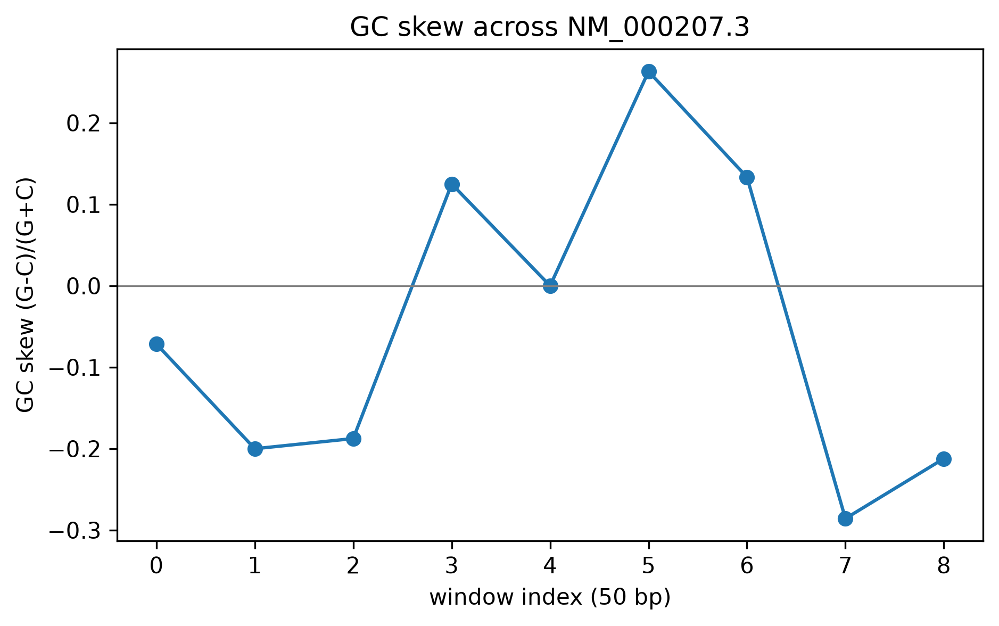

# Sequence Analysis Toolkit

A DNA sequence-analysis toolkit built from first principles in **Python and R**, validated against
established libraries (Biopython, seqinr), applied to the real human insulin (*INS*) mRNA fetched live
from NCBI.



## Aim

Given nothing but a gene's accession number, can I go from raw DNA text to a real biological
read-out — composition, coding regions, protein sequence — using logic I implemented myself, not a
black-box library call, and confirm the result agrees exactly with trusted reference implementations?

## Objective

Implement, from scratch, in both Python and R: GC content, GC skew, k-mer frequency counting, reverse
complement, ORF (open reading frame) detection, and codon-table translation. Cross-validate every
function against Biopython (Python) and seqinr (R). Apply the full toolkit to one real, well-annotated
human gene and confirm the recovered protein matches the known biology.

## Data fetch

Real NCBI RefSeq accession **`NM_000207`** (human insulin mRNA), fetched programmatically via the NCBI
Entrez API — `Bio.Entrez` in Python, `rentrez` in R — not a manually downloaded or bundled tutorial
file. The accession is a parameter, not a hardcoded string, so the same toolkit runs on any gene by
changing one value.

## Data describe

One real transcript: 465 nucleotides, RefSeq-curated (NCBI's own reconciliation of historical Sanger
cDNA sequencing, Human Genome Project genomic sequence, expressed sequence tags, and modern RNA-seq
read alignments into one representative, annotated record — see `PROJECT_NARRATIVE.md` for the full
real data-provenance chain). Contains one annotated coding sequence (CDS) for preproinsulin.

## Methods / Workflow — what we did

1. Fetch the mRNA record from NCBI Entrez and parse it with a custom-built FASTA parser (cross-checked
   against Biopython's `SeqIO` / R's `readLines`).
2. Compute GC content and windowed GC skew by hand (base Python / base R), cross-checked against
   seqinr.
3. Count k-mer (3-mer) frequencies.
4. Compute the reverse complement via a dictionary lookup + reversal, verified with a structural
   self-check: the involution property `revcomp(revcomp(x)) == x` must hold.
5. Scan all three forward reading frames for ORFs (`ATG` to the next in-frame stop codon).
6. Translate the longest ORF via a hand-built 64-entry codon table, and compare to Biopython's/
   seqinr's own `translate()`.
7. Repeat the entire pipeline independently in R, to confirm the results are implementation-independent,
   not an artifact of one toolchain.

## Results

| metric | value |
|--------|-------|
| length | 465 bp |
| GC content | 0.6387 |
| distinct 3-mers | 60 (most frequent: `CTG`) |
| ORFs (forward, ≥60 bp) | 1 |
| longest ORF | 333 bp |
| translated protein | 110 residues, `MALWMRLLPLL...`, ends in stop |

**Python and R produced identical results** — same GC content, same single 333 bp forward ORF, same top
3-mer, same 110-residue translation — each independently cross-checked against its own language's
reference library. Full table: [`results_py/summary.csv`](results_py/summary.csv).

## Biology interpretation of results

The single 333 bp ORF translates to a 110-residue protein beginning `MALWMRLLPLL...` and ending in a
stop codon — this is real, recognizable **preproinsulin** (signal peptide, B-chain, C-peptide, A-chain).
The ~0.64 GC content is consistent with real human coding DNA (typically GC-richer than introns/
intergenic regions, since G–C base pairs have 3 hydrogen bonds vs. A–T's 2, affecting both melting
behavior and, over evolutionary time, coding-region base composition). GC skew is reported for
completeness but isn't biologically meaningful at this scale — the classic replication-origin/leading-
vs-lagging-strand skew signal only applies at genome scale, not on a 465 bp mRNA; that's a real, honest
scope limitation, not a hidden gap. The reverse-complement involution check passing, and the from-scratch
translation matching Biopython/seqinr exactly, are both real correctness proofs, not just "it ran without
error."

## Learning through project

This was the foundational project in the portfolio, and its core lesson carried forward into every later
one: build your own implementation of a concept before trusting a library's version of it, and design a
correctness check into the function itself wherever possible (the involution test) rather than relying
solely on comparison against ground truth. It was also the first appearance of the "validate against a
trusted second implementation" pattern — running the identical analysis independently in Python and R and
requiring exact agreement — which later became the standing cross-language validation discipline used
across the rest of this portfolio, and which caught a real, otherwise-invisible bug in a much later
project (a denominator error found only because two independent language implementations disagreed on
the same number).

## Limitations

ORF detection covers the three forward reading frames only — reverse-strand ORFs are not searched. This
is a single sequence (n=1), so nothing here generalizes genome-wide. GC skew is included for
completeness, not because it carries real biological meaning at mRNA scale.

## Reproduce

```bash
# Python (Google Colab or local)
pip install biopython matplotlib
# open sequence_analysis_toolkit.ipynb and run all cells

# R (RStudio)
install.packages(c("rentrez", "seqinr"))
# open sequence_analysis_toolkit.R in RStudio and Source it
```

Data is pulled live from NCBI (accession `NM_000207`); change the accession to run the toolkit on any
other gene.

## Tech

`Python` (Biopython, matplotlib) · `R` (rentrez, seqinr) · NCBI Entrez API

## Files

```
sequence_analysis_toolkit.ipynb   # Python implementation
sequence_analysis_toolkit.R       # R implementation (RStudio)
results_py/summary.csv            # Python: per-sequence metrics
results_py/gc_skew.png            # Python: GC-skew figure
results_R/summary_R.csv           # R: per-sequence metrics
results_R/gc_skew_R.png           # R: GC-skew figure
```

## License

All rights reserved — see `LICENSE`. This repository is public for portfolio/demonstration purposes
only; no permission is granted to copy, modify, or reuse any part of it.
